  
    
  
  
  
    
  
  
  

 

> *Skip your main quest and it costs you. Clear it and you level up.*

## ✦ The game

<table>
  <tr>
    <td width="300" valign="top" align="center">
      
       A day in QuestFit, in 30 seconds
    </td>
    <td valign="top">
      <h3>⚔ A daily quest board</h3>
      
A main quest and side quests every day, reset at midnight. Clear them for XP and coins.

      <h3>➶ Four classes</h3>
      
Warrior, Ranger, Mage or All-Rounder. Your class sets your board and is matched to your fitness level.

      <h3>✓ Real proof</h3>
      
Your phone's steps, a watch workout synced through Health Connect, or the in-app timer. No smartwatch needed.

      <h3>☠ Stakes you choose</h3>
      
Soft, Balanced or Hardcore decides what a missed day costs. Shields, rest days and sick days protect your streak. Always virtual, never real money.

      <h3>✹ Eight stats, E to S rank</h3>
      
Strength, Cardio, Mobility, Endurance, Discipline, Recovery, Agility and Versatility grow from what you actually log.

    </td>
  </tr>
</table>

## 🌙 Meet JD

  
  
  
  

Your 3D companion starts out unimpressed and warms up as you level: **Aloof** (1 to 5), **Grudging** (6 to 10), **Warm** (11 to 15), then **Proud** at 16 and up.

## 📱 Screens

  
  
  
  

## 🔒 Your data stays on your phone

No accounts, no server. Your campaign and your health data never leave the device. Read the [privacy policy](https://questfit-evj.pages.dev/privacy).

## 🗺 Roadmap

- A character that grows with you, from rough leather at E-Rank to legendary gear at S-Rank
- Reminders you control
- A food log: snap a meal, get calories and macros

## 🛠 Built with

  
  
  
  
  

## Credits

JD uses "AvatarSample_C" by pixiv VRoid Project. The website lives at [armaanxd/questfit-website](https://github.com/armaanxd/questfit-website).

Copyright © 2026 armaanxd. All rights reserved. The code is public to view; it isn't licensed for reuse.
